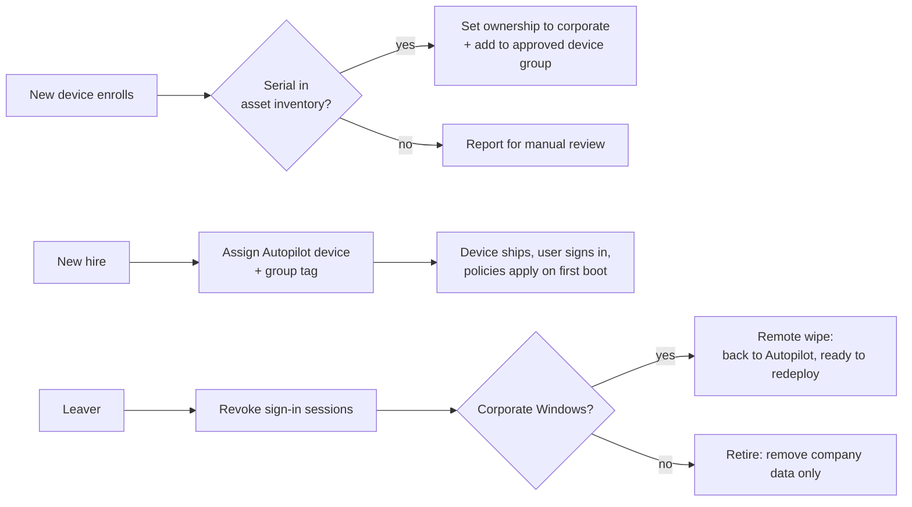

# Intune Lifecycle Automation

PowerShell module that automates the device lifecycle in **Microsoft Intune** with **Microsoft Graph**: approving newly enrolled devices, preparing Autopilot devices for new hires, and securing devices when someone leaves.

It replaces repetitive console work (approving devices one by one, assigning Autopilot devices, reimaging laptops by hand) with auditable, repeatable scripts. In the environment that inspired it, this kind of automation saves **4 to 5 hours of manual work every week**.

> Generic, from-scratch implementation. It contains no data, names or configuration from any real organization.

## What it does



| Function | Purpose |
| --- | --- |
| `Connect-IntuneLifecycle` | Loads config and connects to Graph with app-only certificate auth |
| `Approve-EnrolledDevice` | Approves recently enrolled devices whose serial is in the asset inventory; reports unknown ones |
| `Start-Onboarding` | Assigns an Autopilot device and group tag to a new hire before shipping |
| `Invoke-Offboarding` | Revokes the leaver's sessions, wipes corporate Windows devices for redeployment, retires BYOD |

## Security by design

- **No secrets in code.** App-only auth with a certificate stored in the local certificate store; `config.json`, certificates and logs are git-ignored.
- **Least privilege.** Only the Graph application permissions listed below.
- **Safe by default.** Every function that changes something supports `-WhatIf` and `-Confirm`. `Invoke-Offboarding` is `ConfirmImpact = High`.
- **Never auto-approves the unknown.** Devices not found in the inventory are reported, not approved.
- **Auditable.** Every action is logged with a timestamp, and each function returns objects you can export as a CSV report.

## Requirements

- PowerShell 7.2+
- `Microsoft.Graph.Authentication` module
- An Entra ID app registration with these **application** permissions (admin consent required):

| Permission | Used by |
| --- | --- |
| `DeviceManagementManagedDevices.ReadWrite.All` | Read devices, set ownership |
| `DeviceManagementManagedDevices.PrivilegedOperations.All` | Wipe and retire |
| `DeviceManagementServiceConfig.ReadWrite.All` | Autopilot assignment and group tag |
| `Device.Read.All` | Resolve the Entra device object |
| `GroupMember.ReadWrite.All` | Add devices to the approved group |
| `User.Read.All` | Validate users |
| `User.RevokeSessions.All` | Revoke sign-in sessions on offboarding |

## Setup

```powershell
Install-Module Microsoft.Graph.Authentication -Scope CurrentUser

# 1. Create the app registration, upload the certificate's public key, grant the permissions above
# 2. Copy the example config and fill in your values
Copy-Item ./config.example.json ./config.json

Import-Module ./src/IntuneLifecycle.psd1
Connect-IntuneLifecycle -ConfigPath ./config.json
```

## Usage

Always run with `-WhatIf` first.

```powershell
# Approve devices enrolled in the last 24 hours that are in the inventory
Approve-EnrolledDevice -InventoryPath ./examples/inventory.example.csv -WhatIf

# Prepare a laptop for a new hire
Start-Onboarding -UserPrincipalName new.hire@contoso.com -SerialNumber 5CG1234XYZ

# Offboard a leaver and export the asset report
Invoke-Offboarding -UserPrincipalName leaver@contoso.com |
    Export-Csv ./logs/offboarding-report.csv -NoTypeInformation
```

See [`examples/run-daily.ps1`](examples/run-daily.ps1) for a scheduled job.

## Roadmap

- [ ] macOS: assign Apple Business Manager devices to enrollment profiles
- [ ] Compliance report: devices out of compliance per policy
- [ ] Cleanup of stale and orphaned enrollments
- [ ] Run as an Azure Automation runbook with a managed identity

## License

MIT
